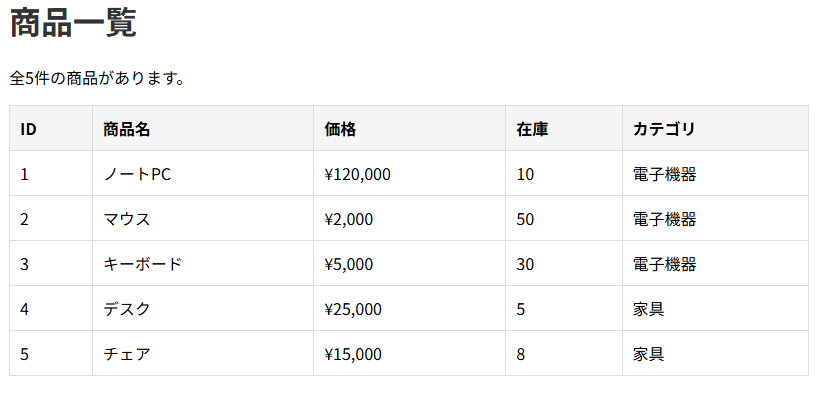

# database-app-practice

## 概要
COACHTECH 教材 Tutorial 9-3「データベース操作ハンズオン演習」で作成した成果物です。

マイグレーションを使った商品一覧を作成した。

## 使用技術
PHP 8.x 
Laravel 10.x 
MySQL 
マイグレーション、シーダー

## 学んだこと
・マイグレーションの作成方法を知った。まだまだ分からないことの方が多く、とても難しく感じる。 
・シーダーやコントローラーを使って作ったが、ブラウザで確認すると中々表示されず困りごとが多かった。 
・クエリビルダーがどういったものかわからず、AIに聞いたりなどした。 
・全体的に終始詰まっていた。どこにどのコードを書くといったことを理解できるように努力したい。

## 動作確認
ブラウザを開いて確認した。映らないことも多かった。 
 
